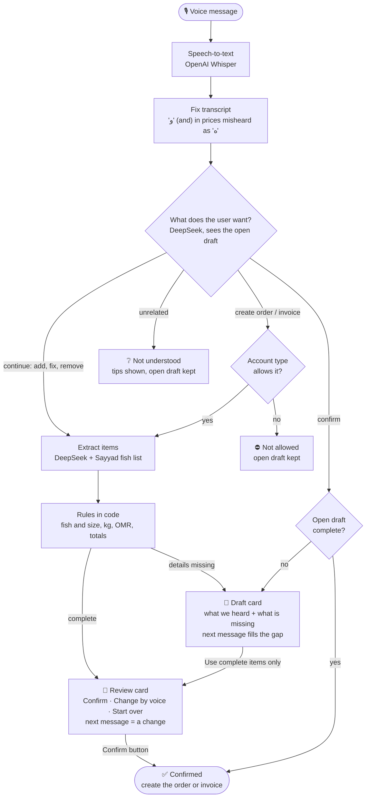
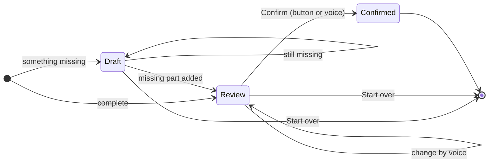

# Voice workflow

One voice message produces one result. An unfinished request stays open as a **draft** and carries over to the next message, until the user confirms it or starts over.

## Flow

Every card waits for the next voice message: it continues the open draft (add, fix, remove or confirm) or starts a new request.

## Draft states

## Who can do what

| Account | Says "I sold…" (invoice) | Says "I want…" (order) |
|---|---|---|
| Buyer | ✗ not allowed | ✓ |
| Seller | ✓ | ✗ not allowed |
| Buyer & seller | ✓ | ✓ |

A seller describing a catch ("صدت ٢٠٠ كيلو كنعد") starts an invoice draft and is asked for prices.

## When is it complete?

| | Every item needs | Calculated in code |
|---|---|---|
| Invoice | fish on the list · quantity · price | kg, OMR per kg, line totals, invoice total (3 decimals) |
| Order | fish on the list · quantity | kg, total weight |

Some items complete, others not: the user can add the missing part by voice, or finish with the complete items only.

## Fish names

| User says | Result |
|---|---|
| A list name or Omani name (كنعد, هامور, قد, kingfish, grouper) | That fish |
| A size (كبير, large) or a size name (خباط, معدود) | That size; no size said → Medium, shown as "(default)" |
| A name that fits several fish (تونة, حبار) | Asks which one and lists the options |
| A fish not on the list (trout) | Flagged; never guessed |

## Prices (Omani rials)

| User says | OMR per kg |
|---|---|
| ريال و٢٠٠ · one rial two hundred · 1.2 rial · ١٢٠٠ بيسة | 1.200 |
| A bare ٨٠٠ for a kilo (50 and above = baisa) | 0.800 |
| بثلاثة · 3 riyals | 3.000 |
| A lump sum ("الكل بأربعمية", "400 for the lot") | lump sum ÷ kg |
| A price per ton | ÷ 1000 |
| ريال ه٢٠٠ (speech-to-text error) | read as ريال و٢٠٠ |

## Two examples

Seller account:

| # | User | System |
|---|---|---|
| 1 | "بعت ١٠٠ كيلو كنعد بأربع ريالات و٥٠ كيلو شعري" | Draft: King Fish ✓ 400.000; Sharry: price missing |
| 2 | "الشعري بريالين" | Review: total 500.000 |
| 3 | "make the king fish 150 kilos" | Review: total 700.000 |
| 4 | Taps Confirm | Confirmed → `POST /api/v1/invoices` |

Buyer account:

| # | User | System |
|---|---|---|
| 1 | "I want 50 kilos of tuna" | Draft: which tuna? Yellow Fin, Long Tail or Sadah |
| 2 | "yellowfin" | Review: Yellow Fin Tuna, Medium (default), 50 kg |
| 3 | "yes, confirm" | Confirmed → `POST /api/v1/orders` |
